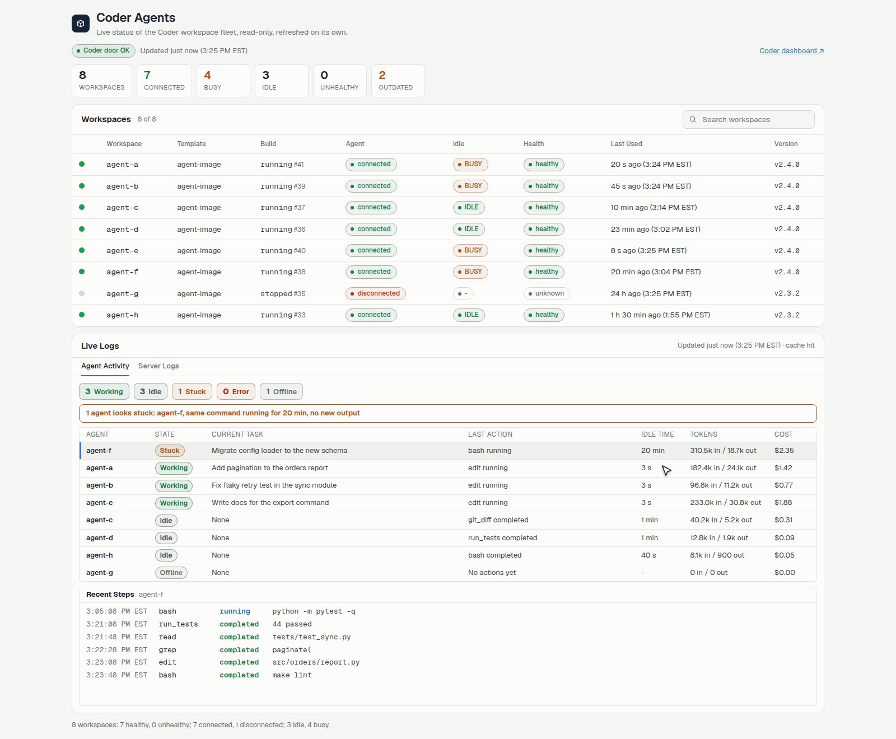
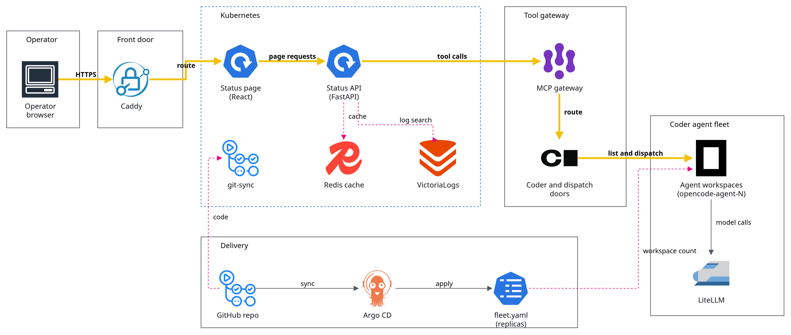

# Coder Fleet

## Executive summary

Coder Fleet is a status board for a fleet of coding-agent workspaces on  [Coder](https://coder.com): it shows which workspaces are running, which agent is busy or idle, and what each one did last, without a command line. Workspaces are plain Coder workspaces that run the  [OpenCode](https://opencode.ai) coding agent against models served through the  [LiteLLM](https://www.litellm.ai) gateway, and a task is handed to one idle workspace at a time. The board is read only: it reports the fleet and never changes it.

- **Fleet** lists one row per workspace with a green or red mark, its build, whether its agent is connected, busy or idle, its health, when it was last used and its version, with a summary count above the table.
- **Activity** shows each agent's state (working, idle, stuck, error or offline) in plain words, its current task, its last action and its recent tool calls, with secrets and internal names removed before anything is shown.
- **Logs** shows recent log lines for the Coder service, the board itself and the dispatch service from  [VictoriaLogs](https://victoriametrics.com/products/victorialogs/), redacted the same way.

## In action

**Check the fleet, then open an agent's recent work.** The page refreshes itself with no refresh button. (Recorded on demo data.)

## Architecture

Coder Fleet is one web page and a small API running together on a self-hosted  [Kubernetes](https://kubernetes.io) cluster. The API holds no Coder credential: it asks the cluster's tool gateway, which talks to Coder and to the dispatch service.

- **Data pipeline.** The API reads workspaces and agent activity through the  [Model Context Protocol](https://modelcontextprotocol.io) gateway and reads logs from  [VictoriaLogs](https://victoriametrics.com/products/victorialogs/). A  [Redis](https://redis.io) cache keeps several open tabs on one shared copy.
- **AI.** The agent workspaces run  [OpenCode](https://opencode.ai) and call open-weight models through  [LiteLLM](https://www.litellm.ai).
- **Web UI.** A  [React](https://vite.dev) page behind  [Caddy](https://caddyserver.com), served with a  [FastAPI](https://fastapi.tiangolo.com) backend in the same pod. Code arrives from the git repository through  [git-sync](https://github.com/kubernetes/git-sync), so a push updates the page without rebuilding an image.
- **Deploy and infrastructure.**  [Argo CD](https://argo-cd.readthedocs.io) keeps the page and the workspace count (a replica setting in one YAML file) in step with git, and it deploys the  [Model Context Protocol](https://modelcontextprotocol.io) tools the agents use.

## License

PolyForm Noncommercial 1.0.0 with a required notice from Haya Tech LLC. Noncommercial use is free; any commercial use, including resale, hosting for others, or a paid product, needs a written license from Haya Tech LLC first. See [LICENSE](LICENSE).
